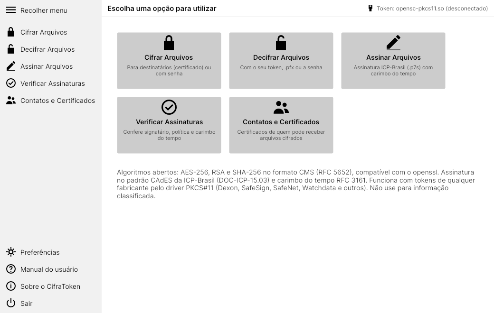
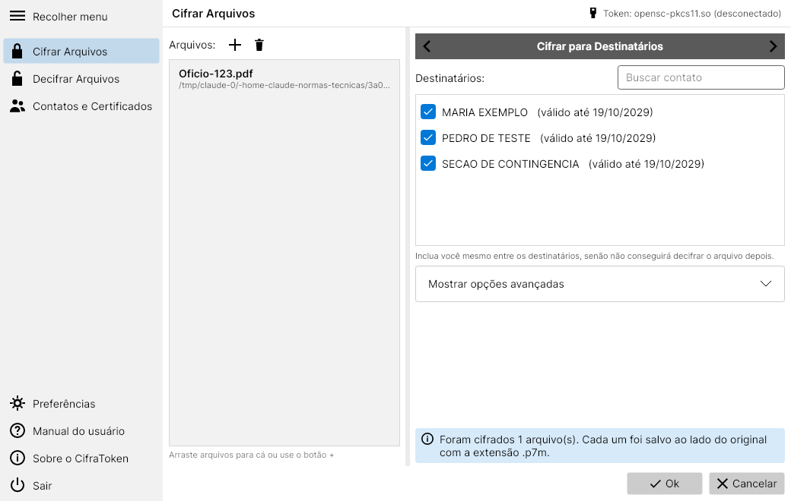
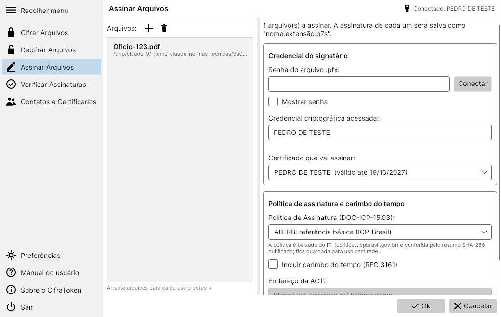
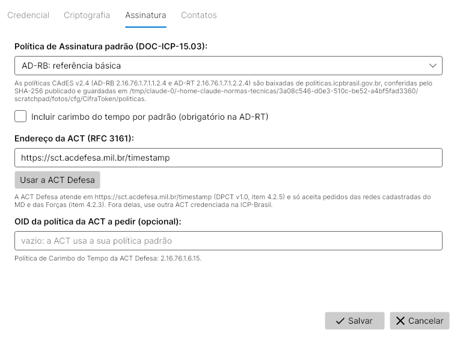
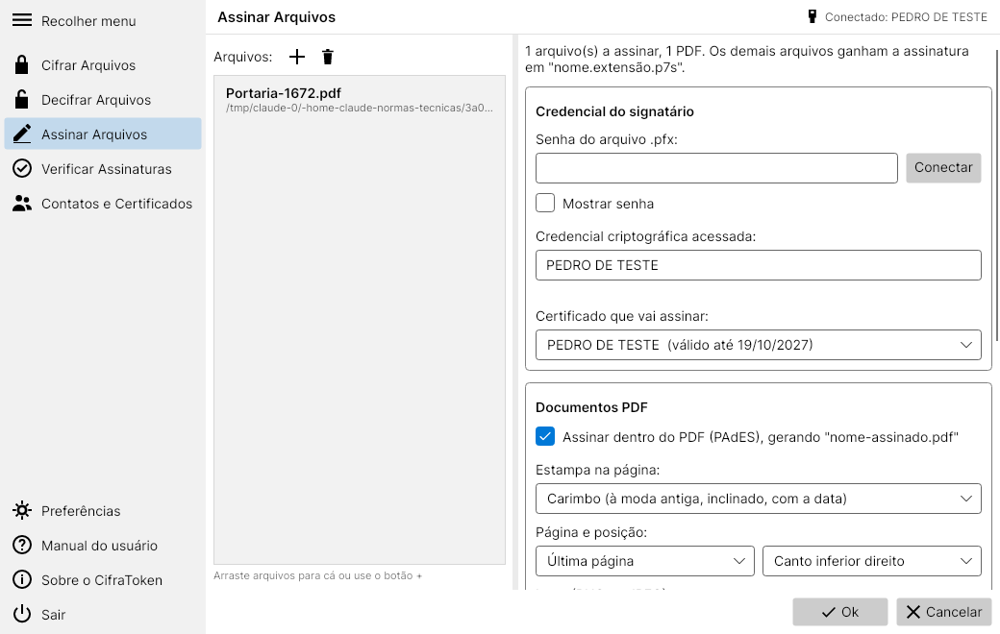
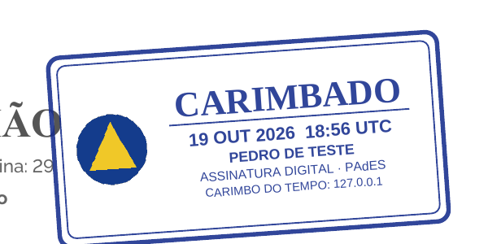
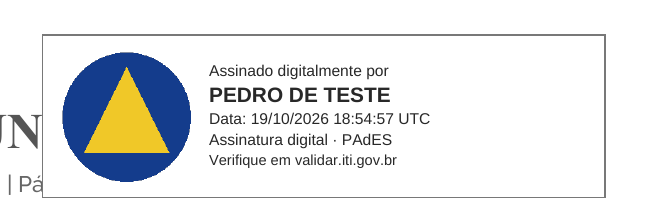
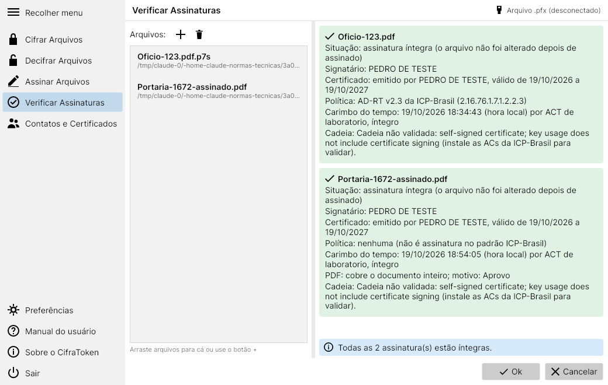

# CifraToken

Aplicativo para Windows e Linux que cifra, decifra e **assina** arquivos com o certificado digital ICP-Brasil
guardado no token de qualquer fabricante (Dexon, G+D SafeSign, SafeNet e outros, pelo driver PKCS#11), num
arquivo .pfx ou com frase-senha. Usa só algoritmos abertos.

- O arquivo é cifrado com **AES-256-CBC** e a chave de sessão com o **RSA** de cada destinatário, no formato
  **CMS EnvelopedData** (RFC 5652, o mesmo do S/MIME). A saída é um `.p7m`.
- É **compatível com o `openssl cms`**: o que o CifraToken cifra o openssl decifra, e vice-versa
  (veja `pareceres/2026-10-19-teste-cifracao-linux.md` na biblioteca do projeto).
- Aceita **vários destinatários** no mesmo arquivo (por exemplo, você e o certificado de contingência do setor).
- A chave privada **não sai do token**: só a chave de sessão do arquivo é decifrada dentro dele.
- **Assina** no padrão CAdES da ICP-Brasil (`.p7s`, DOC-ICP-15.03), com as políticas AD-RB e AD-RT e
  **carimbo do tempo** RFC 3161 de uma ACT configurável (por padrão, a ACT Defesa).
- **Assina dentro do PDF** (PAdES), com uma **estampa de carimbo** à moda antiga ou um quadro de assinatura,
  e o **logo** da sua OM, se quiser.

> Não use para informação classificada. Para isso vale a solução de criptografia de Estado definida pelo seu
> Comando (Decreto 7.845/2012). Faça os testes com arquivos sem valor.

## Onde baixar

Em **Releases** no repositório (coluna da direita), na versão mais recente, em **Assets**:

| Arquivo | Quando usar |
|---|---|
| `CifraToken-win-x64.zip` | Windows 64 bits com driver do token de 64 bits (o normal) |
| `CifraToken-win-x86.zip` | Windows, se o driver do token só existir em 32 bits (em `C:\Windows\SysWOW64`) |
| `CifraToken-linux-x64.tar.gz` | Linux 64 bits |

Descompacte e abra **`CifraToken.exe`** (no Linux, `./CifraToken`): é a janela com as telas abaixo.
O pacote também traz **`cifratoken-cli`** (`cifratoken-cli.exe` no Windows), a linha de comando, para scripts.
Não precisa instalar o .NET.
No Windows, o SmartScreen pode avisar na primeira execução ("Mais informações" > "Executar assim mesmo").

## Telas

A interface segue o fluxo do Quimera: barra de comandos à esquerda (o botão de menu recolhe e expande),
lista de arquivos à esquerda e opções à direita, com **Ok** e **Cancelar** embaixo.





## Primeiro uso

1. Instale o middleware do seu token (Dexon DXSafe, G+D SafeSign, SafeNet, Watchdata etc.) e conecte o token.
2. Abra o CifraToken > **Preferências** > **Credencial**. Em "Driver para acesso ao token", escolha o driver
   na lista dos encontrados (ou **Procurar...** para indicar outra DLL) e clique em **Testar a conexão**
   (lê os certificados sem pedir PIN). No Windows também dá para usar o **repositório de certificados do Windows**,
   e em qualquer sistema um **arquivo PFX** (A1).
3. Em **Contatos e Certificados**, clique em **Adicionar meu certificado** e importe o `.cer` de quem vai
   receber arquivos (por exemplo, o certificado de contingência do setor). Use **Exportar .cer** para mandar o
   seu certificado público a quem vai cifrar para você.

| Driver | Arquivo |
|---|---|
| Dexon DXSafe | `DXSafePKCS11.dll` |
| G+D SafeSign | `aetpkss1.dll` |
| SafeNet / Thales eToken | `eTPKCS11.dll` |
| Watchdata | `WDPKCS.dll` |
| Linux (OpenSC e outros) | `opensc-pkcs11.so` ou o `.so` do fabricante |

## Cifrar Arquivos

Adicione os arquivos (botão **+** ou arrastando). Com as setas da faixa cinza, escolha:
- **Cifrar para Destinatários**: marque os contatos (inclua você mesmo). Gera `ARQUIVO.p7m`.
- **Cifrar com Senha**: frase-senha forte (14+ caracteres). Gera `ARQUIVO.enc`, que abre no Quimera e no openssl.

Os cifrados são salvos ao lado dos originais, que não são apagados.

## Decifrar Arquivos

Adicione os `.p7m` e `.enc`. Para os `.enc`, digite a senha. Para os `.p7m`, digite o PIN e clique em
**Conectar** (se o token avisar que restam poucas tentativas, o aviso aparece antes). Clique em **Ok**:
os decifrados são salvos na mesma pasta, com o nome original. Por padrão a sessão do token é encerrada
após cada uso (Preferências).

## Assinar Arquivos



Adicione os arquivos, conecte a credencial (PIN e **Conectar**), escolha o certificado e a política e clique em
**Ok**. Cada assinatura é salva como `ARQUIVO.p7s` ao lado do original, que não é alterado (assinatura destacada).

| Política | O que é |
|---|---|
| **AD-RB** (padrão) | Referência Básica, CAdES v2.4, OID `2.16.76.1.7.1.1.2.4` (DOC-ICP-15.03 v9.0) |
| **AD-RT** | Referência de Tempo: AD-RB mais o carimbo do tempo sobre a assinatura (exige a ACT) |
| Sem política | CMS simples com a hora do computador; verificável, mas não é o padrão ICP-Brasil |

- A política é baixada do ITI (`politicas.icpbrasil.gov.br`) na primeira vez, conferida pelo SHA-256 publicado ao
  lado do arquivo e pelo resumo que ela mesma traz, e guardada para uso sem rede.
- Atributos assinados: tipo de conteúdo, resumo SHA-256, certificado do signatário (`signing-certificate-v2`) e
  identificador da política (`sigPolicyId`), como pede o DOC-ICP-15.03.
- **Carimbo do tempo**: marque "Incluir carimbo do tempo". A ACT Defesa atende em
  `https://sct.acdefesa.mil.br/timestamp` (DPCT ACT Defesa v1.0, item 4.2.5) e **só aceita pedidos das redes
  cadastradas do MD e das Forças** (item 4.2.3). Fora delas, informe outra ACT credenciada na ICP-Brasil.
  Em **Preferências > Assinatura** ficam a política padrão, o endereço da ACT e o OID da política da ACT
  (ACT Defesa: `2.16.76.1.6.15`).



## Assinar PDF com estampa e logo



Quando a lista tem PDFs, aparece o grupo **Documentos PDF**. Com "Assinar dentro do PDF" marcado, cada PDF vira
`NOME-assinado.pdf` (o original não é alterado), com a assinatura dentro do arquivo. Ela abre no Adobe Reader e no
Verificador do ITI. Os outros arquivos da lista continuam ganhando o `.p7s`.

| Estampa | Como fica |
|---|---|
| **Carimbo** |  |
| **Quadro de assinatura** |  |
| Sem estampa visível | só a assinatura, vista no painel de assinaturas do leitor de PDF |

- Escolha a página (última ou primeira) e a posição (cantos ou centro). O **logo** pode ser PNG ou JPEG e fica
  guardado para as próximas vezes. O **Motivo** (por exemplo, "Aprovo") vai no campo de motivo da assinatura.
- Políticas: **PAdES AD-RB v1.3** (OID `2.16.76.1.7.1.11.1.3`) e **PAdES AD-RT v1.3** (`2.16.76.1.7.1.12.1.3`),
  vigentes de 23/07/2025 a 22/10/2037 (IN ITI nº 34/2025, DOC-ICP-15.03 v9.1). A escolha AD-RB/AD-RT da tela
  vale para os dois formatos.
- O carimbo diz **CARIMBADO** quando há carimbo do tempo e **ASSINADO** quando não há. A estampa é desenhada
  antes da assinatura, então fica protegida por ela. A data na estampa é a do computador no momento de assinar.
  A data oficial é a do carimbo do tempo da ACT, que a verificação mostra.
- Um PDF **já assinado** não é assinado de novo, porque o CifraToken regrava o arquivo e isso invalidaria a
  assinatura anterior. Para coassinar, use o `.p7s`.

## Verificar Assinaturas



Adicione o `.p7s` (ou o original; os dois precisam estar na mesma pasta, como `contrato.pdf` e
`contrato.pdf.p7s`) ou um PDF assinado, e clique em **Ok**. No PDF, todas as assinaturas internas são conferidas,
inclusive as feitas por outros programas, e o CifraToken avisa se o PDF foi alterado depois de alguma delas. Para cada arquivo aparecem: se o arquivo foi alterado depois de assinado,
o signatário, o certificado, a política, a data e hora do carimbo do tempo com a ACT, e a cadeia do certificado.
A cadeia só é validada se as ACs da ICP-Brasil estiverem instaladas no computador; a revogação (LCR) ainda não é
consultada. Para validação jurídica completa, use também o Verificador de Conformidade do ITI
(`validar.iti.gov.br`).

## Linha de comando

```
cifratoken-cli listar --pkcs11                      # certificados do token (procura o DXSafePKCS11.dll)
cifratoken-cli cifrar -i doc.pdf -o doc.pdf.p7m --do-token -r contingencia.cer
cifratoken-cli decifrar -i doc.pdf.p7m -o doc.pdf --pkcs11
cifratoken-cli destinatarios -i doc.pdf.p7m
cifratoken-cli decifrar -i doc.pdf.p7m -o doc.pdf --pfx meu.pfx
cifratoken-cli cifrar-senha -i doc.pdf -o doc.pdf.enc       # formato .enc do Quimera / openssl enc
cifratoken-cli decifrar-senha -i doc.pdf.enc -o doc.pdf
cifratoken-cli assinar -i doc.pdf --pkcs11 --politica AD-RB          # gera doc.pdf.p7s
cifratoken-cli assinar -i doc.pdf --pkcs11 --politica AD-RT --act https://sct.acdefesa.mil.br/timestamp
cifratoken-cli verificar -i doc.pdf                                   # procura doc.pdf.p7s
cifratoken-cli assinar-pdf -i doc.pdf --pkcs11 --politica AD-RT --act https://sct.acdefesa.mil.br/timestamp \
           --estampa carimbo --logo logo.png --pagina ultima --posicao inferior-direito   # gera doc-assinado.pdf
cifratoken-cli verificar -i doc-assinado.pdf                          # confere as assinaturas dentro do PDF
cifratoken-cli politica AD-RB                                         # baixa e mostra a política do ITI
```
O PIN é pedido na tela (ou lido de `CIFRATOKEN_PIN`, apenas para testes automatizados).

## Compatibilidade

| Com | Situação |
|---|---|
| `openssl cms` (Linux/Windows) | compatível nos dois sentidos, DER ou PEM, RSA PKCS#1 v1.5 e OAEP |
| `openssl enc` e Quimera `.enc` (senha) | compatível nos dois sentidos (AES-256-CBC, PBKDF2-SHA512, 1.000.000 de iterações) |
| `openssl cms -verify` (assinatura `.p7s`) | compatível; atributos CAdES conferidos com `openssl cms -cmsout -print` |
| `pdfsig` (poppler) e leitores de PDF | assinatura PAdES válida, tipo `ETSI.CAdES.detached`, documento inteiro coberto |
| Quimera (Marinha) `.acq` | **não** compatível: formato próprio do Quimera para destinatários |

## Limites conhecidos

- O arquivo inteiro é carregado na memória (adequado para documentos; evite arquivos de vários GB).
- Um certificado renovado tem outra chave: arquivos cifrados para o certificado antigo só abrem com o antigo.
- Não apaga o original com segurança; faça isso pelo procedimento do seu setor, se for o caso.
- A verificação não consulta LCR nem OCSP e não confere as regras completas da política (por exemplo, a
  validade do certificado na data do carimbo). Ela confere integridade, signatário, política e carimbo.
- Só RSA (os certificados da AC Defesa e dos tokens comuns são RSA).
- PDF: não coassina um PDF já assinado, não abre PDF protegido por senha, e páginas giradas (paisagem por
  rotação) podem ter a estampa no lugar errado.

## O que foi testado

Automaticamente, a cada alteração (GitHub Actions):
- interoperabilidade com o `openssl cms` (2 destinatários, DER e PEM, PKCS#1 e OAEP, chave errada recusada);
- cifra com senha contra o `openssl enc` com os parâmetros do Quimera;
- assinatura CAdES AD-RT com a política oficial do ITI (v2.3, para teste) e carimbo do tempo de uma ACT de
  laboratório (`openssl ts`), conferida pelo `openssl cms -verify`; arquivo alterado é recusado;
- assinatura PAdES no PDF com estampa e carimbo do tempo, conferida pelo `pdfsig` (poppler); PDF alterado é recusado;
- token simulado (SoftHSM) por PKCS#11: listar, decifrar, cifrar com o certificado do token, assinar, PIN errado;
- no Windows: decifrar pelo repositório "Pessoal" e pelo caminho que o token usa.

**Ainda não testado com tokens físicos (Dexon, SafeSign) nem com a ACT Defesa real**, que só responde nas redes
cadastradas. Esses testes precisam ser feitos no seu computador.

## Código

- `src/CifraToken.Core`: CMS (`CmsCifra.cs`), senha (`SenhaOpenSsl.cs`), assinatura CAdES (`AssinaturaCades.cs`,
  `PoliticaIcp.cs`, `CarimboTempo.cs`), PDF (`AssinaturaPdf.cs`, com [PDFsharp](https://www.pdfsharp.com) 6.2.4,
  licença MIT, e as fontes Liberation, licença SIL OFL 1.1), contatos, acesso ao token por PKCS#11 (`TokenPkcs11.cs`, com a
  biblioteca [Pkcs11Interop](https://github.com/Pkcs11Interop/Pkcs11Interop)) e ao repositório do Windows.
- `src/CifraToken.App`: janela (Avalonia, roda no Windows e no Linux).
- `src/CifraToken.Cli`: linha de comando.
- `tests/`: testes de unidade e `interop.sh` (openssl + SoftHSM).
